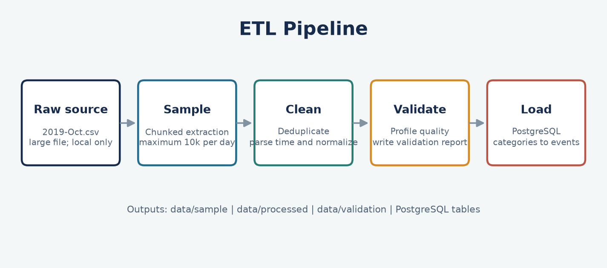
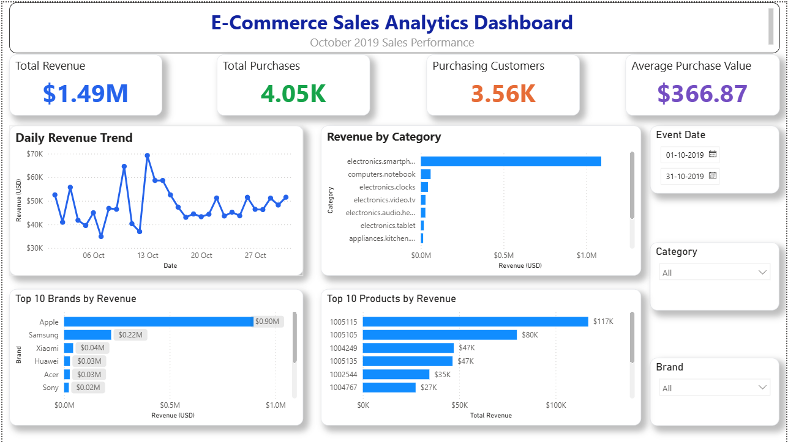
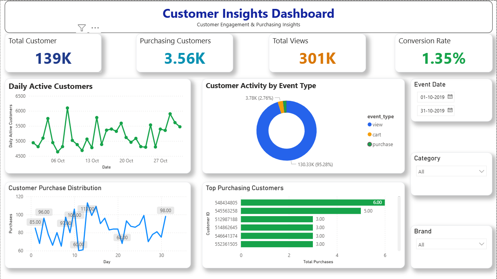
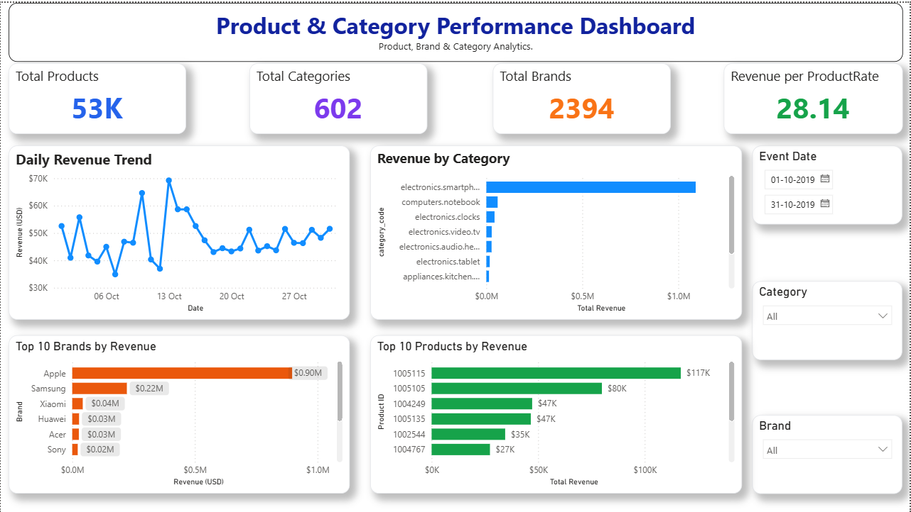
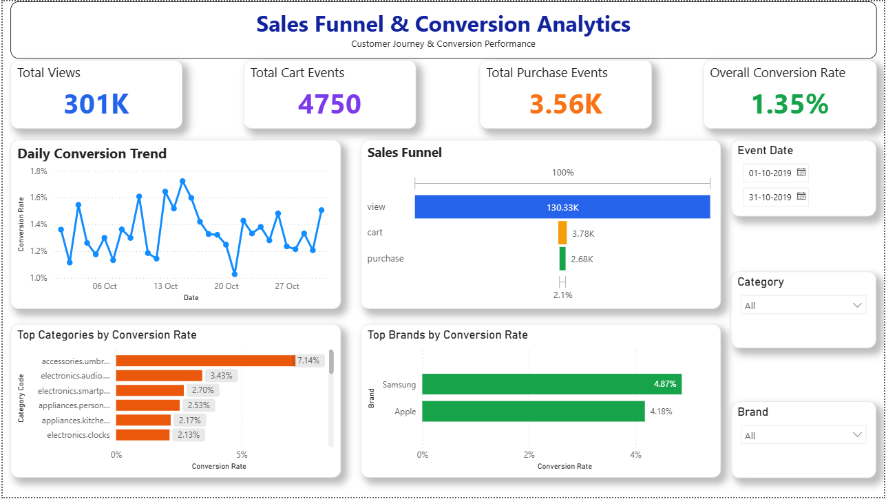

# E-commerce Data Engineering and BI Platform

An end-to-end portfolio project that turns sampled e-commerce event data into a cleaned analytical dataset, a normalized PostgreSQL model, SQL analysis, and a four-page Power BI report.

## Project Overview

This project demonstrates practical data engineering and analytics work across Python, PostgreSQL, SQL, and Power BI. The included October 2019 extract is sampled to keep local processing manageable; all metrics in the report are explicitly sample-level and are not estimates of the complete source month.

## Project Objectives

- Build a repeatable, chunk-based CSV sampling workflow.
- Clean event records and profile data quality with Python and pandas.
- Model categories, products, users, and events in PostgreSQL.
- Answer sales, customer, product, category, conversion, and time-based questions with SQL.
- Deliver interactive Power BI pages and actionable, evidence-based findings.

## Architecture


See [architecture details](docs/architecture.md), [database design](docs/database_design.md), and the [data dictionary](docs/data_dictionary.md).

## Tech Stack

| Area | Tools |
|---|---|
| Data processing | Python 3.12, pandas, NumPy |
| Relational storage | PostgreSQL, psycopg2 |
| Analytics | PostgreSQL SQL |
| Reporting | Power BI |
| Notebook exploration | Jupyter |
| Configuration | python-dotenv |
| Quality checks | unittest, GitHub Actions |

## Dataset

The source is the [eCommerce Behavior Data from Multi Category Store](https://www.kaggle.com/datasets/mkechinov/ecommerce-behavior-data-from-multi-category-store), October 2019 file.

| Artifact | Details |
|---|---|
| Raw source | `data/raw/2019-Oct.csv`; 5.67 GB in the local workspace and excluded from Git |
| Sampling rule | Chunked extraction, capped at 10,000 rows per event date |
| Sample and cleaned records | 309,967 rows across 31 dates; 10 columns |
| Cleaned CSV | `data/processed/ecommerce_cleaned.csv`; approximately 45.6 MB |

The included sample is not the full source dataset. Monthly totals and daily comparisons must not be generalized to all October traffic. To reproduce the sample, download the CSV from Kaggle and place it at `data/raw/2019-Oct.csv`.

## Folder Structure

```text
.
├── .github/workflows/       # Automated Python checks
├── dashboards/              # Power BI report
├── data/
│   ├── raw/                  # Local source CSV; ignored by Git
│   ├── sample/               # Capped analytical sample
│   ├── processed/            # Cleaned dataset
│   └── validation/           # Generated quality profile
├── docs/                     # Architecture, schema, dictionary, AI context
├── images/                   # Dashboard previews and project diagrams
├── notebooks/                # Initial data-understanding notebook
├── reports/                  # Business insights
├── sql/
│   ├── ddl/                  # Database and table definitions
│   ├── dml/                  # Reserved for data-manipulation scripts
│   ├── analytics/            # Business questions and analyses
│   └── views/                # Reserved for analytical views
├── src/
│   ├── cleaning/
│   ├── config/
│   ├── extraction/
│   ├── loading/
│   ├── utils/
│   └── validation/
├── tests/
├── .env.example
├── requirements.txt
└── README.md
```

## ETL Pipeline



1. **Extract and sample:** `src/extraction/create_sample_dataset.py` reads the raw CSV in 100,000-row chunks, parses timestamps, and caps the sample at 10,000 rows per day. Output: `data/sample/ecommerce_sample.csv`.
2. **Clean:** `src/cleaning/clean_ecommerce_data.py` removes duplicate rows, drops invalid event timestamps, and trims/lowercases selected text columns while preserving missing brand and category codes. Output: `data/processed/ecommerce_cleaned.csv`.
3. **Validate:** `src/validation/validate_ecommerce_data.py` writes row/column counts, missingness, duplicate counts, data types, observed event types, records by date, and negative-price counts. Output: `data/validation/validation_report.txt`.
4. **Load:** `src/loading/` inserts categories, products, users, and events in foreign-key order.

## PostgreSQL Database


The schema has four tables: `categories` (category identifiers and codes), `products` (product and category), `users` (customer identifiers), and `events` (timestamped customer interactions and price). Foreign keys connect products to categories and events to products and users. See [database design](docs/database_design.md) and [data dictionary](docs/data_dictionary.md).

## SQL Analytics

There are 12 SQL files: 5 DDL scripts and 7 analytics scripts. The analytics files contain 39 numbered business questions plus one exploratory session query. Topics include revenue and average purchase value, customer activity and spending, product/category/brand rankings, event-based funnel ratios, hourly and daily patterns, and window-function analysis (ranking, running totals, moving averages, and `LAG`).

## Power BI Dashboard

Open [`ecommerce_sales_analytics_dashboard.pbix`](dashboards/ecommerce_sales_analytics_dashboard.pbix) in Power BI Desktop. The report has four pages, 48 visual containers, 16 chart visuals, 16 KPI cards, 12 slicers, and 4 page-title text boxes. Each page includes event-date, category, and brand filters.

## Dashboard Pages

**1. Executive Dashboard** - Sample purchase revenue, purchase count, purchasing customers, average purchase value, daily revenue, revenue by category, top brands, and top products.



**2. Customer Insights Dashboard** - Customer and purchasing-customer counts, views, the displayed conversion KPI, daily active customers, event mix, purchase distribution, and leading purchasing customers.



**3. Product and Category Performance** - Product/category/brand coverage, revenue per product rate, daily revenue, category revenue, top brands, and top products.



**4. Sales Funnel and Conversion Analytics** - View/cart/purchase cards, conversion trend, funnel visual, and category/brand conversion rankings.



The conversion measures should be interpreted as event-count ratios unless explicitly defined at the session/customer level. The funnel page's purchase card also needs reconciliation with the source counts; details are documented in the [business insights report](reports/business_insights.md).

## Business Insights

The included sample records $1.486M in purchase-event revenue. Smartphone category revenue is 73.4% of that sample total, Apple represents 60.3%, and 3,558 unique customers made a purchase. The data is capped by date, category codes are missing on 32.8% of event rows, and the funnel visuals use inconsistent purchase labels. See the [18-observation business report](reports/business_insights.md) for impacts, recommendations, and methodology.

## Project Workflow

```text
Raw Data
   |
   v
Sampling and Cleaning
   |
   v
Validation
   |
   v
PostgreSQL
   |
   v
SQL Analytics
   |
   v
Power BI
   |
   v
Business Insights
```

## Installation

Requirements: Python 3.12, PostgreSQL, and Power BI Desktop for opening the `.pbix` file.

```powershell
py -3.12 -m venv .venv
.\.venv\Scripts\Activate.ps1
python -m pip install -r requirements.txt
Copy-Item .env.example .env
```

Set `DB_HOST`, `DB_PORT`, `DB_NAME`, `DB_USER`, and `DB_PASSWORD` in the local `.env` file. It is ignored by Git. Create the database and tables from the repository root:

```bash
psql -d postgres -f sql/ddl/create_database.sql
psql -d ecommerce_bi -f sql/ddl/create_categories.sql
psql -d ecommerce_bi -f sql/ddl/create_products.sql
psql -d ecommerce_bi -f sql/ddl/create_users.sql
psql -d ecommerce_bi -f sql/ddl/create_events.sql
```

## Usage

Run commands from the repository root. Place the Kaggle file in `data/raw/` before sampling.

```bash
python -m src.extraction.create_sample_dataset
python -m src.cleaning.clean_ecommerce_data
python -m src.validation.validate_ecommerce_data
python -m src.loading.load_all
python -m unittest discover -s tests -v
```

The notebook `notebooks/01_data_understanding.ipynb` previews the raw data. The database loading command requires a reachable PostgreSQL server and valid local credentials.

## Resume Highlights

Counts below are derived from the current repository and included cleaned CSV. Dataset statistics describe the capped sample, not the full source month.

| Measure | Verified value |
|---|---:|
| Python source scripts | 9 |
| Reusable Python function definitions in `src/` | 18 |
| Core pipeline entry points | 4 (sample, clean, validate, load) |
| SQL scripts | 12 |
| Numbered analytical questions plus session query | 40 |
| PostgreSQL tables | 4 |
| Power BI reports / pages | 1 / 4 |
| Power BI visuals | 48 total: 16 charts, 16 KPI cards, 12 slicers, 4 titles |
| Diagnostic groups in the validation report | 6 |
| Business insights in the report | 18 |
| Sampled, cleaned event records | 309,967 |
| Cleaned CSV size | 45.6 MB |
| Raw CSV size in the local workspace | 5.67 GB; excluded from Git |
| Distinct category IDs / non-null category codes | 602 / 126 |
| Distinct products / non-null brands | 52,823 / 2,393 |
| Distinct customers / purchasing customers | 139,048 / 3,558 |
| Sample purchase events / purchase-event revenue | 4,051 / $1,486,209.46 |
| DAX measure count | Not independently verified from the PBIX model; not claimed |

## Future Improvements

- Define session-based funnel and cart-abandonment measures, then reconcile all report-page KPI definitions.
- Improve category-code and brand coverage with documented unknown-value handling.
- Add automated schema and business-rule assertions to validation.
- Make loading idempotent and transactional, then add database integration tests.
- Add incremental ingestion, orchestration, and monitoring for production-scale data.

## Author

Maintained as an individual data engineering and business intelligence portfolio project by the owner of the GitHub repository.