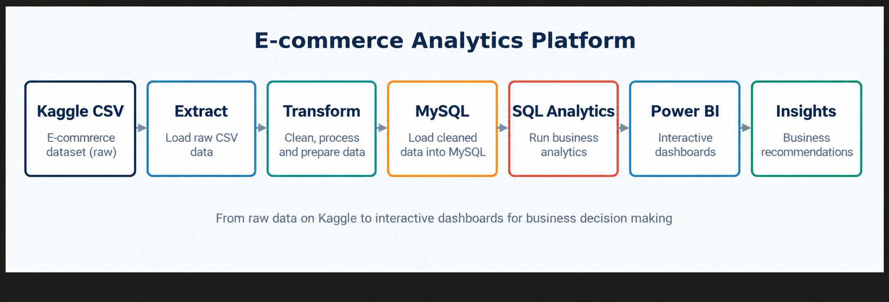

# Architecture

## Data flow

1. Download the October 2019 source CSV and place it at `data/raw/2019-Oct.csv`. Raw downloads are excluded from Git.
2. Run the extraction sampler to create `data/sample/ecommerce_sample.csv`, capped at 10,000 rows per event date.
3. Clean the sample into `data/processed/ecommerce_cleaned.csv`.
4. Profile the cleaned data and write `data/validation/validation_report.txt`.
5. Create the MySQL database and tables with `sql/ddl/`, then load categories, products, users, and events.
6. Query the analytics layer in `sql/analytics/` and connect Power BI to MySQL.

## Components

- `src/extraction/`: chunked CSV sampling, capped at a fixed number of rows per event date.
- `src/cleaning/`: duplicate removal, timestamp parsing, and text normalization.
- `src/validation/`: dataset profiling and a plain-text validation report.
- `src/loading/`: MySQL connection and ordered table loaders.
- `sql/ddl/`: database and normalized table definitions.
- `sql/analytics/`: business queries for sales, customers, products, conversion, and time trends.
- `dashboards/`: Power BI dashboard file; `images/` contains exported previews.

## Configuration

Copy `.env.example` to `.env`, set the MySQL connection values, and keep `.env` untracked. Data and configuration paths resolve from the repository root; run documented module commands from that root. The included data and dashboard figures describe a capped sample, not the full source month.
