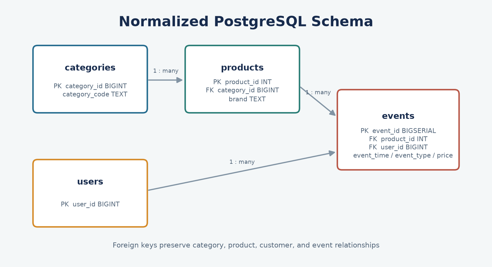

# Database Design

The schema separates product categories, products, users, and event facts. It is defined by the SQL scripts in `sql/ddl/` and supports the analytical queries in `sql/analytics/`.

## Tables

| Table | Grain | Primary key | Foreign keys |
|---|---|---|---|
| `categories` | One source category identifier | `category_id` | None |
| `products` | One product identifier | `product_id` | `category_id` -> `categories.category_id` |
| `users` | One customer identifier | `user_id` | None |
| `events` | One recorded interaction | `event_id` | `product_id` -> `products.product_id`; `user_id` -> `users.user_id` |

## Design Notes

- `events` is the central fact table. `event_type`, `event_time`, `event_date`, and `price` support funnel and time-series analysis.
- `products` carries the product-to-category relationship and nullable brand. `categories` retains the source category identifier and optional descriptive code.
- Event loading follows the dependency order categories, products, users, then events so foreign-key references exist before event insertion.
- `event_id` is a database-generated surrogate key. The source `user_session` remains on each event for session-level analysis.
- The schema does not enforce a controlled event-type domain or guarantee idempotent loads; those are candidates for future constraints and loader improvements.

See the [data dictionary](data_dictionary.md) for column types and meanings.